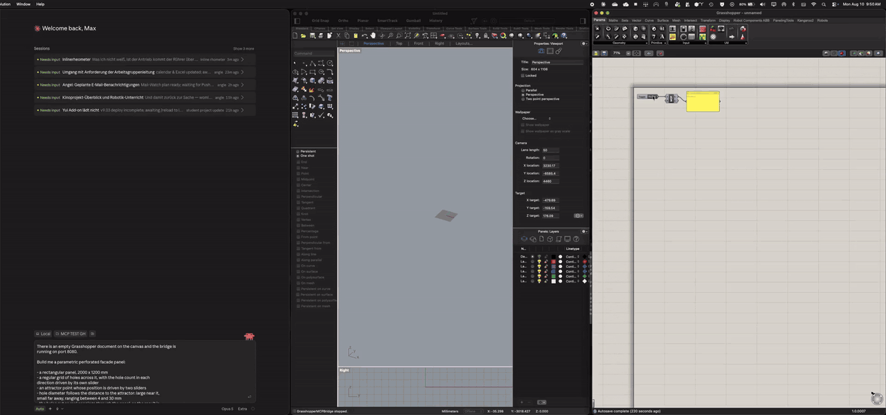

# Grasshopper Agent Bridge

**An AI assistant can only build what it can verify.** This is an MCP server for Grasshopper
that lets an assistant not only write to a live canvas, but **observe, measure and correct**
it — a closed loop instead of blind generation:

```
act        place a component, wire it, set a value
measure    what data is flowing? what turned red? where did it land?
correct    delete, disconnect, re-wire, lay out — and prove it worked
```



*Left: the assistant. Right: the live canvas and the Rhino viewport. Three real sessions —
build, modify, self-correct — sped up 6× to 25× from about twenty minutes. The long quiet stretch
at the start is a **cold start**: the assistant is reading its skill and the repository docs
before it touches an empty canvas. That cost is paid once; later sessions on the same definition
begin producing components within seconds. → [examples/facade-panel/](examples/facade-panel/)*

The difference sounds small and is everything. Without the measuring half, an assistant
produces canvases that look plausible and compute nothing, and a human has to read the screen
aloud to it after every step. With it, the assistant catches its own mistakes — wrong
components, dead wires, wrong data-tree branches — before you ever look up.

It is general-purpose: any definition, any plugin, nothing domain-specific.

## Quickstart

You need **Rhino 7 with Grasshopper**, and an MCP client such as Claude Code.

**1. Install the plugin.** Take `GH_MCP.gha` from the
[latest release](../../releases/latest), copy it into Grasshopper's Libraries folder, clear the
download quarantine and restart Rhino. Details and the build-it-yourself route:
[docs/install.md](docs/install.md).

**2. Switch the bridge on.** In Grasshopper, place **Grasshopper MCP** (Params → Util), wire a
Boolean Toggle to it and set it to `True`. The status reads `Running on port 8080`.

**3. Connect your assistant.** In Claude Code, the plugin brings the MCP server and the skills
in one step:

```
/plugin marketplace add chmhechtl/grasshopper-agent-bridge
/plugin install grasshopper-agent-bridge@grasshopper-agent-bridge
```

In any other MCP client, register the server from a clone of this repository:

```bash
claude mcp add grasshopper -- uv run /path/to/grasshopper-agent-bridge/server/gh_mcp_server.py
```

**4. Run `/onboarding-grasshopper-bridge`.** The assistant checks the connection, explains
every command and what the bridge makes possible, and offers a first live demo.

## What the assistant can do

32 tools, one per bridge command, with the same names and arguments.

| | Tools | Why it matters |
|---|---|---|
| **Observe** | `get_document_info`, `get_component_info`, `get_connections`, `get_layout`, `search_components` | The assistant sees what is really on the canvas: components, wiring, real bounding boxes |
| **Measure** | `get_component_output`, `get_errors`, `recompute` | Runtime warnings and the **data itself**, with its tree structure — the only honest success check |
| **Build** | `add_component`, `connect_components`, `add_variable_parameter` | Place by GUID, wire by index, reach parameters a plugin hides in its right-click menu |
| **Correct** | `disconnect_components`, `delete_component`, `set_enabled` | A mistake can be undone instead of buried under a workaround |
| **Set values** | `set_component_value`, `set_slider`, `set_param_value`, `set_value_list`, `set_colour`, `set_script` | Panels, sliders, toggles, unwired inputs, list selections, embedded scripts |
| **Keep it legible** | `set_nickname`, `create_group`, `add_to_group`, `remove_from_group`, `set_component_position`, `set_component_size`, `set_wire_display`, `set_preview` | The canvas stays readable for the humans who inherit it |
| **Hand over** | `bake_component`, `save_document`, `load_document`, `clear_document` | Results into Rhino; versioned checkpoints, so any experiment is one command from rollback |

Every parameter and every trap: [docs/commands.md](docs/commands.md).

## The skills

Four skills teach the assistant how to use the tools well. The Claude Code plugin installs
them; otherwise drop them into your agent's skills folder (for Claude Code: `.claude/skills/`).
Each is a single `SKILL.md` and loads on its own when the situation matches.

| Skill | For |
|---|---|
| [onboarding-grasshopper-bridge](skills/onboarding-grasshopper-bridge/SKILL.md) | **Start here.** `/onboarding-grasshopper-bridge` — a guided tour: connection check, every command by purpose, the rules, the limits |
| [gh-canvas](skills/gh-canvas/SKILL.md) | **Building.** Place by GUID, wire, verify the data, keep the canvas readable |
| [gh-diagnose](skills/gh-diagnose/SKILL.md) | **Something is wrong.** A read-only procedure: messages → data → wires → trees → orphans, before anything is changed |
| [gh-bridge-dev](skills/gh-bridge-dev/SKILL.md) | **The bridge is missing a command.** Handler, registration, build, redeploy — and how to reach plugin internals by reflection |

## The rules that made it work

The full list with evidence is in [docs/pitfalls.md](docs/pitfalls.md), the working method in
[docs/workflow.md](docs/workflow.md). The three that prevent most damage:

1. **Place components by GUID, never by name.** Name lookup happily returns an OBSOLETE twin
   or a parameter container with the same label — in vanilla Grasshopper too.
2. **Judge success by the data, not by the reply.** A wiring call can report success and
   connect nothing. `get_component_output` shows what actually flows.
3. **When the order is wrong, look at the data tree** before you look at your logic.

## Layout: what a measurable canvas gets you

An agent-built definition works and is unreadable — components where they happened to land,
wires crossing everywhere, panels at their 120×60 default cutting off the output you care about.
A canvas nobody can read is a canvas nobody can audit.

An agent has no eye for this. It cannot look at the screen and see two components overlapping.
But `get_layout` returns real bounding boxes and connection grips, `get_connections` returns the
graph — and once the geometry is *measurable*, a readable canvas stops being a matter of taste:

```bash
python3 tools/gh_layout.py --check   # 287 components checked, 14 real overlaps
python3 tools/gh_layout.py           # columns by data flow, rows by barycenter,
                                     # groups in bands, wires straightened, one batched write
```

Layering by longest path, rows ordered to keep wires short, panels sized by what they hold,
single-consumer wires nudged dead horizontal, overlaps repaired against real bounds. `--check`
and `--fix-overlaps` are surgical: they touch only what genuinely collides and leave everything
a human placed alone. Full walkthrough in [docs/layout.md](docs/layout.md).

**The bridge contains no layout engine.** It exposes measurable geometry, and a few hundred
lines of plain Python do the rest. That generalises: whatever else you want an agent to reason
about on a canvas is the same shape of problem.

## Example

**[examples/facade-panel/](examples/facade-panel/)** — a panel with a grid of holes sized by an
attractor point, built from an outcome-level brief in about nine minutes. Vanilla Grasshopper
only, nothing to install. Worth reading not because it worked, but because the agent knew *why*
it worked at each step: it measured the removed material to confirm the holes were real
openings, verified a rotation by the resulting centroid rather than by the angle it fed in,
and — between two sessions — correctly worked out that the sliders had been moved by hand rather
than "fixing" the human's edits. It also turned up two genuine limitations, including one in the
layout tool that `--check` could not see.

## How it is built

```
Grasshopper  ←  GH_MCP.gha  ←  JSON over a local socket  ←  MCP server  ←  your assistant
```

```
bridge/      the .gha source (C#, Rhino 7 / .NET Framework 4.8) — 37 commands on 127.0.0.1:8080
server/      the MCP server (one Python file) and its two self-checks
skills/      the four agent skills
tools/       optional operator helpers: layout, checkpoints, preview control
docs/        install, commands, workflow, pitfalls, layout, protocol
examples/    a worked example with its recording
```

Grasshopper itself needs nothing but the one `.gha`. Everything else runs outside, on the
operator's machine.

**No MCP client?** The bridge underneath is a plain socket speaking line-delimited JSON, usable
from any language — [docs/protocol.md](docs/protocol.md) has a ten-line client, `tools/gh.py`
is the same with a command-line entry point.

## Status and scope

Working tool, not polished product: the API is stable enough to build on, the code still
carries its origins. Built and tested on **Rhino 7 for macOS**; the project targets
.NET Framework 4.8 and should load in Rhino 7 on Windows unchanged (unverified). Rhino 8 is
untested.

`server/test_server.py` checks the MCP server without Rhino; `server/test_live.py` runs every
tool against a running bridge.

## Origin, license and attribution

A fork of [alfredatnycu/grasshopper-mcp](https://github.com/alfredatnycu/grasshopper-mcp) by
Alfred Chen, which built the plugin architecture and the write half: an assistant could place
and connect components. What was missing was the closed loop — reading the canvas back — and
that is what this fork adds, along with its own MCP server.

MIT, see [LICENSE](LICENSE) — inherited from upstream and kept. [NOTICE.md](NOTICE.md) lists
what came from where.
